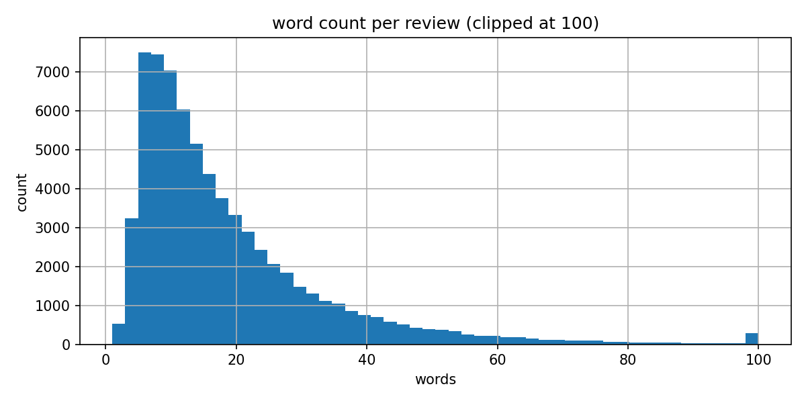
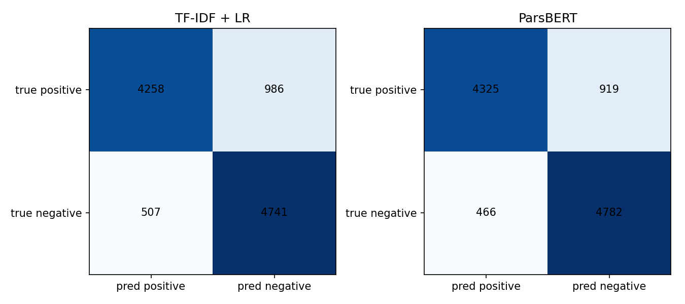
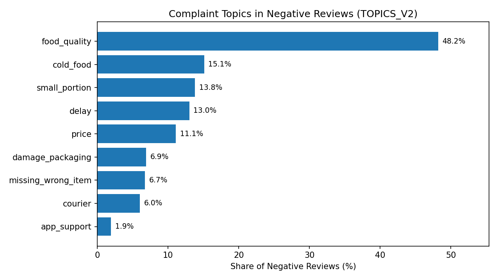

# CX-Radar: سامانه تحلیل نظرات مشتریان و ریشه‌یابی شکایات (اسنپ‌فود)

[🇺🇸 English Version Below](#-english-version)

پروژه جامع **تحلیل داده و پردازش زبان فارسی (Persian NLP)** روی **۷۰٬۰۰۰ نظر واقعی کاربران اسنپ‌فود** که با هدف تبدیل بازخوردهای متنی به **بینش‌های اجرایی و ریشه‌یابی شکایات** طراحی شده است. به‌جای اکتفا به دسته‌بندی ساده «مثبت / منفی» (`HAPPY` / `SAD`)، این پروژه کیفیت داده خام را حسابرسی می‌کند، مدل پایه قابل‌تفسیر (`TF-IDF + Logistic Regression`) را با مدل عمیق فارسی (`ParsBERT`) از نظر آماری مقایسه می‌کند، خطاهای مدل‌ها را بررسی می‌کند و موضوعات اصلی نارضایتی را استخراج می‌نماید.

## مسئله کسب‌وکار و رویکرد تحلیلی

در پلتفرم‌های سفارش آنلاین غذا، روزانه حجم بالایی از نظرات متنی ثبت می‌شود. برچسب صرفاً مثبت یا منفی نشان می‌دهد «آیا مشتری ناراضی بوده است؟»، اما پاسخ نمی‌دهد «علت اصلی نارضایتی چیست و کدام تیم عملیاتی یا محصولی باید اقدام کند؟».

این پروژه سه سوال کلیدی تحلیل داده را پاسخ می‌دهد:

1. **سلامت و بازیابی داده:** چقدر از اطلاعات دیتاست خام به دلیل خطای ساختار یا شیفت ستون‌ها در خطر از دست رفتن است و چگونه می‌توان آن را بازیابی کرد؟

2. **مقایسه مدل‌ها و ارزش افزوده:** آیا مدل `ParsBERT` نسبت به مدل سریع و شفاف `TF-IDF + Logistic Regression` برتری معناداری دارد و هزینه/پیچیدگی بیشتر آن چه زمانی توجیه‌پذیر است؟

3. **ریشه‌یابی شکایات:** بیشترین شکایات کاربران منفی حول چه موضوعاتی شکل می‌گیرد و چقدر نظرات ترکیبی (مثلاً تعریف از طعم همراه با گلایه از حجم کم یا تأخیر) باعث خطای مدل‌های تک‌برچسبی می‌شوند؟

## یافته‌های کلیدی و نتایج کمی

### ۱. حسابرسی کیفیت داده و پاکسازی یکپارچه

* **دیتاست خام:** ۷۰٬۰۰۰ ردیف در فایل `Snappfood Sentiment Analysis.csv` بدون مقدار خالی در ستون‌های `comment` و `label`.

* **کشف و بازیابی ۵۲۰ ردیف شیفت‌شده:** در بررسی اولیه مشخص شد ۵۲۰ ردیف به دلیل شیفت ستون‌ها، برچسب عددی (`0` / `1`) در ستون `label` و متن اصلی در ستون `Unnamed: 0` قرار گرفته‌اند. این ردیف‌ها بدون حذف بازیابی شدند (`rescued=True`) و ترکیب نهایی به **۳۵٬۰۰۰ نظر `HAPPY` و ۳۵٬۰۰۰ نظر `SAD`** رسید.

* **نرمال‌سازی و حذف تکراری‌ها:** پس از نرمال‌سازی با `hazm`، یکسان‌سازی ارقام، کنترل کشیدگی حروف، حذف **۴ متن با برچسب متناقض** و حذف **۵۵ تکراری واقعی**، **۶۹٬۹۴۱ رکورد تمیز** با توزیع متوازن (۵۰٪ مثبت / ۵۰٪ منفی) به دست آمد؛ میانگین طول نظرات **۱۸.۵ کلمه** و میانه آن **۱۴ کلمه** است.



### ۲. ارزیابی مدل‌ها روی مجموعه تست ($n = 10,492$)

تقسیم داده به‌صورت لایه‌بندی‌شده (`Stratified`) بر اساس ترکیب `is_negative` و `rescued` انجام شد (`48,958` train / `10,491` val / `10,492` test).

| مدل | دقت تست (فاصله اطمینان ۹۵٪) | Macro-F1 تست | دقت روی ردیف‌های بازیابی‌شده ($n=78$) | ویژگی‌های کلیدی | 
| ----- | ----- | ----- | ----- | ----- | 
| **TF-IDF (1–2 n-gram) + Logistic Regression** | `0.8577` ($\pm 0.0067$) | `0.8574` | `0.910` | سریع، سبک، قابل‌تفسیر با بررسی وزن کلمات مثبت/منفی | 
| **ParsBERT (`bert-fa-base-uncased`)** | **`0.8680`** ($\pm 0.0065$) | **`0.8677`** | `0.885` | درک عمیق‌تر بافت فارسی؛ نیازمند GPU برای آموزش | 



* **آزمون آماری جفتی (دوجمله‌ای دقیق / مک‌نمار):** روی مجموعه تست، `ParsBERT` در **۴۱۰** مورد که `TF-IDF` اشتباه کرده بود درست پیش‌بینی کرد و `TF-IDF` در **۳۰۲** مورد که `ParsBERT` اشتباه کرده بود درست پیش‌بینی کرد ($p = 5.89 \times 10^{-5}$)؛ این عدد نشان می‌دهد برتری آماری `ParsBERT` معنادار است.

* **تحلیل خطا (Error Analysis):** روی مجموعه اعتبارسنجی (`val`) در **۹۹۶** مورد هر دو مدل اشتباه کردند (۷۳۱ مورد با برچسب واقعی مثبت و ۲۶۵ مورد با برچسب واقعی منفی). بررسی نمونه‌ها نشان می‌دهد بخش مهمی از خطاها مربوط به **نظرات دوگانه/ترکیبی** است (مثلاً کیفیت یا پیک خوب بوده اما حجم کم، تأخیر، سرد شدن یا گرانی وجود داشته است).

### ۳. دسته‌بندی موضوعی شکایات (`TOPICS_V1` vs. `TOPICS_V2`)

برای تبدیل نظرات منفی به شاخص‌های قابل‌پیگیری برای تیم‌های عملیات، کیفیت غذا، بسته‌بندی و پشتیبانی، الگوی استخراج موضوع چندبرچسبی در ۹ دسته تعریف شد و نتایج `TOPICS_V2` بر روی نظرات منفی استخراج گردید:

| دسته شکایت (`TOPICS_V2`) | سهم در نظرات منفی |
| ----- | ----- |
| `food_quality` (کیفیت غذا) | `48.2%` |
| `cold_food` (سرد بودن غذا) | `15.1%` |
| `small_portion` (حجم کم غذا) | `13.8%` |
| `delay` (تأخیر در ارسال) | `13.0%` |
| `price` (قیمت و هزینه) | `11.1%` |
| `damage_packaging` (آسیب یا بسته‌بندی نامناسب) | `6.9%` |
| `missing_wrong_item` (قلم جاافتاده یا اشتباه) | `6.7%` |
| `courier` (پیک و برخورد تحویل‌دهنده) | `6.0%` |
| `app_support` (اپلیکیشن و پشتیبانی) | `1.9%` |



## ساختار ریپازیتوری و خروجی‌های گزارش (`reports/`)

```
cx-radar/
├── notebooks/
│   └── 01_data_snappfood.ipynb        # نوت‌بوک کامل (حسابرسی داده، EDA، مدل‌سازی و تحلیل موضوعات)
├── reports/
│   ├── results.json                   # معیارهای نهایی Accuracy و Macro-F1 دو مدل روی مجموعه تست (n=10,492)
│   ├── topics_comparison_v1_v2.csv    # جدول مقایسه پوشش موضوعات شکایت در V1 و V2
│   └── figures/
│       ├── word_count_dist.png        # نمودار توزیع طول نظرات
│       ├── confusion_matrix.png       # ماتریس درهم‌ریختگی دو مدل روی تست
│       └── negative_topics_share.png  # نمودار سهم موضوعات شکایت در نظرات منفی
├── requirements.txt
├── .gitignore
└── README.md

```

## نحوه اجرا و بازتولید نتایج

1. **باز کردن در Google Colab:** نوت‌بوک `notebooks/01_data_snappfood.ipynb` را در Google Colab باز کنید و Runtime را روی **GPU (مانند Tesla T4)** تنظیم نمایید.

2. **تنظیم توکن Kaggle:** توکن API خود را در بخش **Secrets** کولب با نام دقیق `KAGGLE_API_TOKEN` ذخیره کنید تا کلید دسترسی وارد کد یا GitHub نشود.

3. **اجرای کامل نوت‌بوک:** گزینه `Runtime -> Run all` را بزنید تا دیتاست با `kagglehub` دریافت شود، پاکسازی و تقسیم داده انجام گیرد، مدل‌ها آموزش ببینند و خروجی‌ها در پوشه `reports/` (`results.json` و تصاویر پوشه `figures/`) ذخیره شوند.

## ابزارها و فناوری‌ها

* **تحلیل و آماده‌سازی داده:** `Python`، `pandas`، `NumPy`، `SciPy`، `PyArrow`

* **پردازش زبان فارسی و مدل‌سازی:** `hazm`، `scikit-learn` (`TfidfVectorizer`، `LogisticRegression`)، `PyTorch`، `Hugging Face Transformers` (`HooshvareLab/bert-fa-base-uncased`)

* **مصورسازی:** `Matplotlib`

# 🌐 English Version

An end-to-end **Data Analytics & Persian NLP** project built on **70,000 SnappFood customer reviews**. Going beyond binary sentiment classification (`HAPPY` vs. `SAD`), **CX-Radar** audits raw data quality, rescues 520 column-shifted records, benchmarks an interpretable statistical baseline (`TF-IDF + Logistic Regression`) against a fine-tuned Persian transformer (`ParsBERT`) with paired statistical significance testing, performs error analysis, and categorizes complaint drivers for business teams.

## Highlights & Key Results

* **Data Quality & Recovery:** Recovered **520 shifted rows** (`rescued=True`) to preserve all **70,000 raw reviews** (35,000 `HAPPY` / 35,000 `SAD`), then normalized text with `hazm` and removed **4 conflicting-label texts** and **55 real duplicates**, resulting in **69,941 clean reviews** (50% positive / 50% negative).

* **Holdout Test Performance (**$n = 10,492$**):**

  * **TF-IDF (1–2 n-gram) + Logistic Regression:** Accuracy `0.8577` ($\pm 0.0067$), Macro-F1 `0.8574`, Rescued accuracy `0.910`.

  * **ParsBERT (`bert-fa-base-uncased`):** Accuracy `0.8680` ($\pm 0.0065$), Macro-F1 `0.8677`, Rescued accuracy `0.885`.

  * **Paired Exact Binomial Test:** ParsBERT outperformed TF-IDF statistically significantly ($p = 5.89 \times 10^{-5}$; 410 ParsBERT-only vs. 302 TF-IDF-only correct predictions on test).

* **Complaint Root-Cause Analysis (`TOPICS_V2`):** Multi-label Persian regex taxonomy across 9 operational complaint categories led by `food_quality` (`48.2%`), `cold_food` (`15.1%`), `small_portion` (`13.8%`), `delay` (`13.0%`), `price` (`11.1%`), `damage_packaging` (`6.9%`), `missing_wrong_item` (`6.7%`), `courier` (`6.0%`), and `app_support` (`1.9%`).

## Report Artifacts (`reports/`)

* `reports/results.json`: Exported holdout test metrics (`accuracy` and `macro_f1`) for both `TF-IDF + LR` and `ParsBERT` across $n = 10,492$ test samples.
* `reports/figures/word_count_dist.png`: Distribution of word counts per review (clipped at 100 words).
* `reports/figures/confusion_matrix.png`: Side-by-side confusion matrices comparing `TF-IDF + LR` and `ParsBERT` on the holdout test set.
* `reports/figures/negative_topics_share.png`: Share of each complaint topic (`TOPICS_V2`) across negative reviews.

## How to Run

1. Open `notebooks/01_data_snappfood.ipynb` in **Google Colab** with a **GPU** runtime.

2. Add your Kaggle token to Colab Secrets as `KAGGLE_API_TOKEN`.

3. Run all cells to reproduce preprocessing, training, evaluation, and exports in `reports/`.
